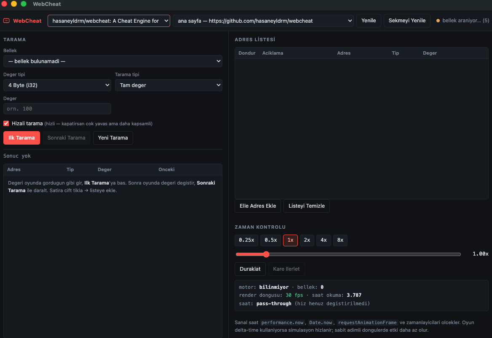
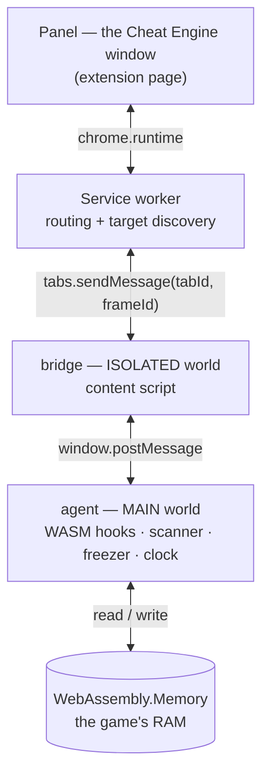

<div align="center">

# WebCheat

**A Cheat Engine for browser games — as a Chrome extension.**

Scan the game's WebAssembly memory, find the address behind a value, edit it, freeze it,
and speed up or slow down time. No local server, no debug flags, no attaching a debugger.

[](https://github.com/hasaneyldrm/webcheat/actions/workflows/test.yml)
[](LICENSE)
[](manifest.json)
[](package.json)

[Install](#install) · [Quick start](#quick-start) · [How it works](#how-it-works) · [Türkçe](README.tr.md)

<br>



<sub>Pick a tab, scan, narrow, edit, freeze — and drive the clock. The diagnostics box tells you what the target frame is actually doing.</sub>

</div>

---

## What it is

Unity, Godot and Emscripten WebGL games keep their entire game state inside a single
`WebAssembly.Memory` — one flat `ArrayBuffer`. That buffer is the exact browser equivalent
of the process RAM that Cheat Engine scans.

WebCheat hooks WebAssembly before the game instantiates, keeps a reference to that memory,
and gives you the classic scan → narrow → edit → freeze workflow against it.

**Zero dependencies. Zero build step. Nothing runs outside the browser.**

## Features

| | |
|---|---|
| **Value scanning** | Exact, greater, less, between, unknown-initial-value |
| **Narrowing** | Changed, unchanged, increased, decreased, increased by N, decreased by N |
| **All-types scan** | Scan `i8 · i16 · i32 · i64 · f32 · f64` simultaneously; each result carries its own type |
| **Smart lane pruning** | Type lanes that cannot represent your value are skipped — typing `300` never scans `i8` |
| **Aligned + unaligned** | Fast typed-array path, or byte-by-byte for packed structs |
| **Write & freeze** | Edit any address; freeze rewrites it at 60 Hz so the game can't take it back |
| **Time control** | 0.25×–8× speed, pause, single-frame step — via a virtual clock |
| **iframe aware** | Targets individual frames, so games embedded cross-origin work |
| **Live diagnostics** | Tells you *why* something isn't working instead of failing silently |

## Install

Not on the Chrome Web Store — load it unpacked:

```bash
git clone https://github.com/hasaneyldrm/webcheat.git
```

1. Open `chrome://extensions`
2. Enable **Developer mode** (top right)
3. Click **Load unpacked** → select the cloned folder
4. Pin the extension to your toolbar

> **Then reload the game tab once.** WebAssembly hooks must be installed *before* the game
> creates its memory, so the agent runs at `document_start`. Tabs that were already open have
> no agent yet. The panel's **Reload tab** button does this for you.

## Quick start

Find and lock a coin counter in about a minute:

1. Click the **WebCheat** icon — a panel window opens
2. Pick your tab from the dropdown (`[WASM]` means memory was found)
3. Read the value off the screen — say coins = `100`. Type it, hit **First Scan**
4. Play until the value changes — say coins = `250`. Type it, hit **Next Scan**
5. Repeat until one address remains
6. **Double-click** the row → it drops into the Address List
7. Type a new value in its **Value** cell → written straight to memory
8. Tick **Freeze** → the game can no longer change it

**Don't know the value?** (a health bar with no number, a hidden timer)

1. Value type **All**, scan type **Unknown initial value** → **First Scan** (takes a snapshot)
2. Let the value change in game
3. **Next Scan** → **Increased** / **Decreased** / **Changed**
4. Repeat 3–4 times

### Picking a value type

| Looking for | Try |
|---|---|
| Score, coins, level, ammo, lives | `i32` |
| Health bar, speed, timers, positions | `f32` |
| No idea | **All (every type)** |
| Found nothing at all | Turn **Aligned scan** off — slower, but catches packed structs |

> In **All** mode the same address can appear under several types. The low two bytes of an
> `i32` holding `4242` also read as `i16` `4242`. Cheat Engine behaves identically — narrowing
> clears the duplicates.

### Time control

A virtual clock rescales `performance.now`, `Date.now`, `requestAnimationFrame` timestamps
and `setTimeout`/`setInterval` delays.

- **0.25×–8×** presets or a free slider
- **Pause** — speed 0, delta time 0, the game freezes
- **Frame step** — while paused, advance the clock by exactly one frame (16.67 ms)

Games that derive movement from delta time genuinely run faster. Fixed-timestep loops respond
less, since their simulation step is constant by design.

> While the speed has **never been changed**, the clock is a pure pass-through. This is
> deliberate: the extension injects into `<all_urls>`, and normal browsing must be untouched.

## How it works



**Why the two content-script worlds:** patching `WebAssembly.instantiate` requires running in
the page's own JS realm (`MAIN`), but that realm has no access to `chrome.*` APIs. A second
script in the `ISOLATED` world relays messages between them.

**Why scanning happens in the page:** a Unity heap is routinely 256 MB–1 GB. Shipping that
across the message channel every scan would be absurd. The agent scans in place and returns
only matching offsets plus one page of results.

**What gets hooked:** `WebAssembly.instantiate`, `instantiateStreaming`, `new WebAssembly.Instance`,
`new WebAssembly.Memory`, plus a throttled sweep of globals to catch Emscripten modules
(`Module.HEAPU8`, `unityInstance.Module.wasmMemory`) that were created before the hooks landed.

**Growth safety:** WASM memory can grow mid-scan, which detaches the old `ArrayBuffer`.
The scanner re-acquires the live buffer every chunk and aborts loudly rather than silently
returning a half-scanned result.

## WebCheat vs Cheat Engine

| | WebCheat | Cheat Engine |
|---|---|---|
| Target | Browser tabs / iframes | Native OS processes |
| Attach | Pick a tab, no debugger | Pick a process |
| Memory model | `WebAssembly.Memory` buffer | Process virtual memory |
| Value scan + narrowing | ✅ | ✅ |
| All-types scan | ✅ | ✅ |
| Write / freeze | ✅ | ✅ |
| Speedhack | ✅ virtual clock | ✅ |
| Pointer scan | ❌ *(planned)* | ✅ |
| AOB / string scan | ❌ *(planned)* | ✅ |
| Disassembler / debugger | ❌ | ✅ |
| Lua scripting | ❌ | ✅ |

WebCheat is deliberately the small end of that table: the scan-and-edit loop, done well, for
the web.

## Troubleshooting

The tab dropdown labels every tab so you always know where you stand:

| Label | Meaning | Fix |
|---|---|---|
| `[WASM]` | Agent present, memory found | Ready — scan away |
| *(none)* | Agent present, no memory yet | Game is still loading; the panel keeps polling |
| `[agent yok]` | Content script never injected | Hit **Reload tab** |
| `[askıda]` | Chrome discarded the tab | Visit the tab once, then **Refresh** |

The **diagnostics line** under Time Control explains speed problems directly:

| It says | Meaning |
|---|---|
| `render döngüsü: 60 fps · saat okuma: 14.203` | Healthy — speed control will work |
| `bu frame'de çalışan bir oyun döngüsü yok` | Wrong frame selected |
| `oyun saati hiç okumuyor` | Fixed-timestep game; speed can't affect it |
| `paylaşımlı bellek (pthread)` | Game loop lives in a Worker — scanning works, time control can't reach it |

## Development

```bash
node test/engine.test.mjs     # or: npm test
```

33 assertions run the scan engine against a synthetic 4 MB `WebAssembly.Memory` in Node:
region discovery, i32/f32 exact scans, narrowing, the unknown-value snapshot flow, all-types
multi-lane scanning, lane pruning, write, freeze, error propagation, virtual clock and diagnostics.

```
manifest.json           MV3 manifest
src/agent/agent.js      MAIN world — hooks, scanner, freezer, virtual clock
src/bridge/bridge.js    ISOLATED world — message relay
src/bg/service-worker.js  routing, target discovery, panel window
src/ui/                 the panel (HTML/CSS/JS, no framework)
test/engine.test.mjs    engine tests
```

## Limitations & roadmap

- **No pointer scan.** Addresses shift on every page load, so you rescan each session. This is
  the single biggest gap versus Cheat Engine and the top roadmap item.
- **No AOB / string scan.** Numeric types only.
- **Pure-JS games aren't scannable.** Phaser, PixiJS and plain-canvas games keep state on the JS
  heap, not in WASM linear memory. A JS object scanner is planned. If the panel reports no
  memory, the game is probably pure JS.
- **Result cap: 4,000,000 addresses.** Exceeding it stops the scan and warns you — it never
  truncates silently.
- **Mixed 64-bit precision.** Single-type `i64`/`u64` scans keep full BigInt precision. In
  **All** mode, mixed lanes share one numeric table, so `i64` values above 2⁵³ lose precision.
  Pick a single type if that matters.
- **Workers are out of reach.** Content scripts don't run in Web Workers, so pthread-based
  builds that drive their loop from a worker won't respond to time control.

## Contributing

Issues and pull requests are welcome. There is no build step and no dependency to install —
clone, edit, reload the extension. Please keep `node test/engine.test.mjs` green, and add
assertions for anything you change in the scan engine.

## Responsible use

WebCheat is a development and analysis tool: for testing your own games, balancing them
quickly, and inspecting client-side state.

Using it to gain an advantage in someone else's multiplayer game or on a leaderboard breaks
that platform's terms of service. That's on you, and it's not what this is for.

## License

[MIT](LICENSE) © Hasan Emir Yıldırım
