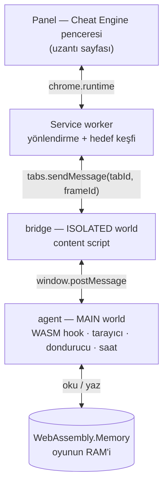

<div align="center">

# WebCheat

**Tarayıcı oyunları için Cheat Engine — Chrome uzantısı olarak.**

Oyunun WebAssembly belleğini tara, bir değerin arkasındaki adresi bul, değiştir, dondur;
zamanı hızlandır ya da yavaşlat. Local sunucu yok, debug bayrağı yok, debugger bağlama yok.

[](https://github.com/hasaneyldrm/webcheat/actions/workflows/test.yml)
[](LICENSE)
[](manifest.json)
[](package.json)

[Kurulum](#kurulum) · [Hızlı başlangıç](#hızlı-başlangıç) · [Nasıl çalışıyor](#nasıl-çalışıyor) · [English](README.md)

<br>


<sub>Sekmeyi seç, tara, daralt, değiştir, dondur — ve saati sür. Teşhis kutusu hedef frame'in gerçekte ne yaptığını söyler.</sub>

</div>

---

## Bu nedir

Unity, Godot ve Emscripten WebGL oyunları bütün oyun durumunu tek bir `WebAssembly.Memory`
içinde tutar — düz bir `ArrayBuffer`. O buffer, Cheat Engine'in taradığı process RAM'inin
tarayıcıdaki birebir karşılığıdır.

WebCheat, oyun instantiate etmeden önce WebAssembly'yi hook'lar, o belleğe referans tutar ve
sana klasik tara → daralt → değiştir → dondur akışını verir.

**Sıfır bağımlılık. Sıfır build adımı. Tarayıcı dışında hiçbir şey çalışmıyor.**

## Özellikler

| | |
|---|---|
| **Değer tarama** | Tam değer, büyüktür, küçüktür, arasında, bilinmeyen başlangıç değeri |
| **Daraltma** | Değişti, değişmedi, arttı, azaldı, şu kadar arttı, şu kadar azaldı |
| **Tüm tipler** | `i8 · i16 · i32 · i64 · f32 · f64` aynı anda; her sonuç kendi tipini taşır |
| **Akıllı şerit eleme** | Değeri temsil edemeyen tipler atlanır — `300` yazınca `i8` hiç taranmaz |
| **Hizalı + hizasız** | Hızlı typed-array yolu, ya da paketlenmiş struct'lar için bayt bayt |
| **Yazma ve dondurma** | Herhangi bir adresi düzenle; dondurma 60 Hz'de geri yazar, oyun geri alamaz |
| **Zaman kontrolü** | 0.25×–8× hız, duraklat, kare kare ilerlet — sanal saat üzerinden |
| **iframe farkında** | Frame bazında hedefleme; cross-origin gömülü oyunlar çalışır |
| **Canlı teşhis** | Sessizce başarısız olmak yerine *neden* çalışmadığını söyler |

## Kurulum

Chrome Web Store'da değil — paketlenmemiş yükle:

```bash
git clone https://github.com/hasaneyldrm/webcheat.git
```

1. `chrome://extensions` aç
2. Sağ üstten **Geliştirici modu**'nu aç
3. **Paketlenmemiş öğe yükle** → klonladığın klasörü seç
4. Uzantıyı araç çubuğuna sabitle

> **Sonra oyun sekmesini bir kez yenile.** WebAssembly hook'ları oyun belleğini oluşturmadan
> *önce* takılmak zorunda, o yüzden agent `document_start`'ta çalışıyor. Zaten açık olan
> sekmelerde henüz agent yok. Paneldeki **Sekmeyi Yenile** düğmesi bunu senin için yapar.

## Hızlı başlangıç

Bir coin sayacını bulup kilitlemek yaklaşık bir dakika:

1. **WebCheat** ikonuna bas — panel penceresi açılır
2. Açılır listeden sekmeni seç (`[WASM]` = bellek bulundu demek)
3. Değeri ekrandan oku — diyelim coin = `100`. Yaz, **İlk Tarama**'ya bas
4. Değer değişene kadar oyna — diyelim coin = `250`. Yaz, **Sonraki Tarama**
5. Tek adres kalana kadar tekrarla
6. Satıra **çift tıkla** → Adres Listesi'ne düşer
7. **Değer** hücresine yeni sayıyı yaz → doğrudan belleğe yazılır
8. **Dondur**'u işaretle → oyun artık değiştiremez

**Değeri bilmiyorsan?** (sayısı olmayan can barı, gizli sayaç)

1. Değer tipi **Hepsi**, tarama tipi **Bilinmeyen başlangıç değeri** → **İlk Tarama** (snapshot alır)
2. Oyunda değerin değişmesini sağla
3. **Sonraki Tarama** → **Arttı** / **Azaldı** / **Değişti**
4. 3–4 kez tekrarla

### Tip seçimi

| Aradığın | Dene |
|---|---|
| Skor, coin, level, mermi, can sayısı | `i32` |
| Can barı, hız, süre, pozisyon | `f32` |
| Hiçbir fikrin yok | **Hepsi (tüm tipler)** |
| Hiçbir şey bulamadın | **Hizalı tarama**'yı kapat — yavaş ama paketlenmiş struct'ları yakalar |

> **Hepsi** modunda aynı adres birden fazla tiple çıkabilir. `4242` tutan bir `i32`'nin alt iki
> baytı `i16` olarak da `4242` eder. Cheat Engine de aynen böyle davranır — daraltma tekrarları eler.

### Zaman kontrolü

Sanal saat `performance.now`, `Date.now`, `requestAnimationFrame` timestamp'lerini ve
`setTimeout`/`setInterval` gecikmelerini ölçekler.

- **0.25×–8×** hazır kademeler veya serbest slider
- **Duraklat** — hız 0, delta time 0, oyun donar
- **Kare İlerlet** — duraklatılmışken saati tam bir kare (16.67 ms) iter

Hareketi delta time'dan türeten oyunlar gerçekten hızlanır. Sabit adımlı döngüler daha az
tepki verir, çünkü simülasyon adımları tasarım gereği sabittir.

> Hız **hiç değiştirilmediği sürece** saat tamamen pass-through kalır. Bu bilinçli: uzantı
> `<all_urls>`'e enjekte oluyor ve normal gezinmenin etkilenmemesi gerekiyor.

## Nasıl çalışıyor



**Neden iki content-script dünyası:** `WebAssembly.instantiate`'i yamalamak sayfanın kendi JS
realm'inde (`MAIN`) çalışmayı gerektirir, ama o realm `chrome.*` API'lerine erişemez.
`ISOLATED` dünyadaki ikinci script ikisi arasında mesaj taşır.

**Neden tarama sayfanın içinde:** bir Unity heap'i rutin olarak 256 MB–1 GB'tır. Bunu her
taramada mesaj kanalından geçirmek saçma olurdu. Agent yerinde tarar, sadece eşleşen
offsetleri ve bir sayfa dolusu sonucu döner.

**Neler hook'lanıyor:** `WebAssembly.instantiate`, `instantiateStreaming`,
`new WebAssembly.Instance`, `new WebAssembly.Memory`; ayrıca hook'lardan önce oluşmuş
Emscripten modüllerini (`Module.HEAPU8`, `unityInstance.Module.wasmMemory`) yakalamak için
kısıtlanmış bir global taraması.

**Büyüme güvenliği:** WASM belleği tarama ortasında büyüyebilir ve eski `ArrayBuffer` detach
olur. Tarayıcı her parçada canlı buffer'ı yeniden alır ve yarım sonuç dönmektense açıkça hata verir.

## WebCheat ile Cheat Engine

| | WebCheat | Cheat Engine |
|---|---|---|
| Hedef | Tarayıcı sekmeleri / iframe'ler | Yerel işletim sistemi süreçleri |
| Bağlanma | Sekme seç, debugger yok | Process seç |
| Bellek modeli | `WebAssembly.Memory` buffer | Process sanal belleği |
| Değer tarama + daraltma | ✅ | ✅ |
| Tüm tipler taraması | ✅ | ✅ |
| Yazma / dondurma | ✅ | ✅ |
| Speedhack | ✅ sanal saat | ✅ |
| Pointer scan | ❌ *(planlanıyor)* | ✅ |
| AOB / string tarama | ❌ *(planlanıyor)* | ✅ |
| Disassembler / debugger | ❌ | ✅ |
| Lua betikleme | ❌ | ✅ |

WebCheat bilinçli olarak bu tablonun küçük ucu: tara-ve-düzenle döngüsünü, web için, düzgün yapmak.

## Sorun giderme

Sekme listesi her sekmeyi etiketler, nerede durduğunu hep bilirsin:

| Etiket | Anlamı | Çözüm |
|---|---|---|
| `[WASM]` | Agent var, bellek bulundu | Hazır — tara |
| *(etiketsiz)* | Agent var, henüz bellek yok | Oyun yükleniyor; panel yoklamaya devam eder |
| `[agent yok]` | Content script hiç enjekte olmamış | **Sekmeyi Yenile**'ye bas |
| `[askıda]` | Chrome sekmeyi uykuya almış | Sekmeye bir uğra, sonra **Yenile** |

Zaman Kontrolü altındaki **teşhis satırı** hız sorunlarını doğrudan açıklar:

| Yazan | Anlamı |
|---|---|
| `render döngüsü: 60 fps · saat okuma: 14.203` | Sağlıklı — hız kontrolü çalışır |
| `bu frame'de çalışan bir oyun döngüsü yok` | Yanlış frame seçili |
| `oyun saati hiç okumuyor` | Sabit adımlı oyun; hız etki edemez |
| `paylaşımlı bellek (pthread)` | Oyun döngüsü bir Worker'da — tarama çalışır, zaman kontrolü ulaşamaz |

## Geliştirme

```bash
node test/engine.test.mjs     # ya da: npm test
```

33 assertion, tarama motorunu Node'da sahte bir 4 MB `WebAssembly.Memory` üzerinde koşturur:
bölge keşfi, i32/f32 tam değer taraması, daraltma, bilinmeyen-değer snapshot akışı, çok
şeritli "hepsi" taraması, şerit eleme, yazma, dondurma, hata bildirimi, sanal saat ve teşhis.

```
manifest.json           MV3 manifest
src/agent/agent.js      MAIN world — hook'lar, tarayıcı, dondurucu, sanal saat
src/bridge/bridge.js    ISOLATED world — mesaj rölesi
src/bg/service-worker.js  yönlendirme, hedef keşfi, panel penceresi
src/ui/                 panel (HTML/CSS/JS, framework yok)
test/engine.test.mjs    motor testleri
```

## Sınırlar ve yol haritası

- **Pointer scan yok.** Adresler her sayfa yüklemesinde kayar, her seansta yeniden tararsın.
  Cheat Engine'e göre en büyük eksik ve yol haritasının ilk maddesi.
- **AOB / string taraması yok.** Sadece sayısal tipler.
- **Saf JS oyunlar taranamıyor.** Phaser, PixiJS ve düz canvas oyunları durumu WASM lineer
  belleğinde değil JS heap'inde tutar. JS obje tarayıcısı planlanıyor. Panel "bellek yok"
  diyorsa oyun muhtemelen saf JS.
- **Sonuç tavanı: 4.000.000 adres.** Aşılırsa tarama durur ve uyarır — asla sessizce kırpmaz.
- **Karışık 64-bit hassasiyeti.** Tek tipli `i64`/`u64` taramaları tam BigInt hassasiyetini
  korur. **Hepsi** modunda karışık şeritler tek bir sayısal tabloyu paylaşır, bu yüzden 2⁵³
  üstündeki `i64` değerleri hassasiyet kaybeder. Önemliyse tek tip seç.
- **Worker'lara ulaşılamıyor.** Content script'ler Web Worker'da çalışmaz; döngüsünü worker'dan
  süren pthread build'leri zaman kontrolüne tepki vermez.

## Katkı

Issue ve pull request'ler açıktır. Build adımı ve kurulacak bağımlılık yok — klonla, düzenle,
uzantıyı yenile. Lütfen `node test/engine.test.mjs`'i yeşil tut ve tarama motorunda
değiştirdiğin her şey için assertion ekle.

## Sorumlu kullanım

WebCheat bir geliştirme ve analiz aracıdır: kendi oyunlarını test etmek, hızlıca dengelemek
ve client-side durumu incelemek için.

Başkasının çok oyunculu oyununda veya bir skor tablosunda avantaj sağlamak için kullanmak o
platformun kullanım şartlarını ihlal eder. Sorumluluğu sana ait ve bu araç bunun için değil.

## Lisans

[MIT](LICENSE) © Hasan Emir Yıldırım
